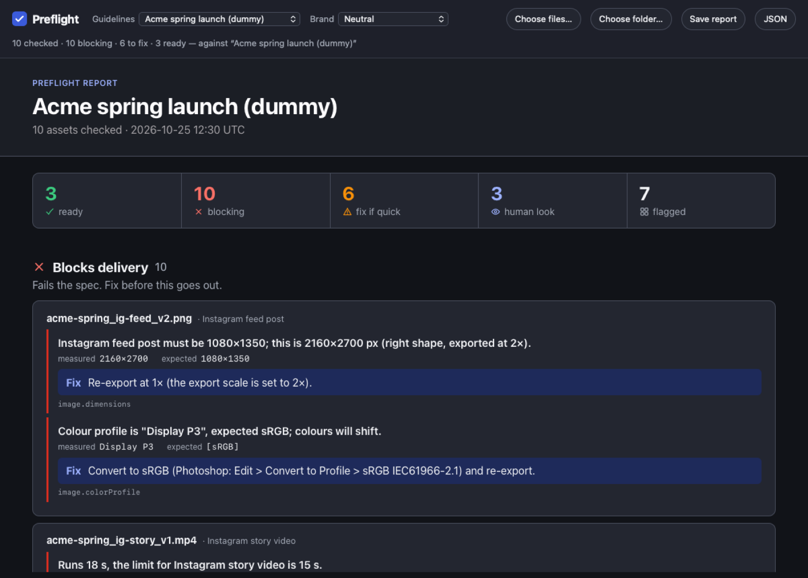
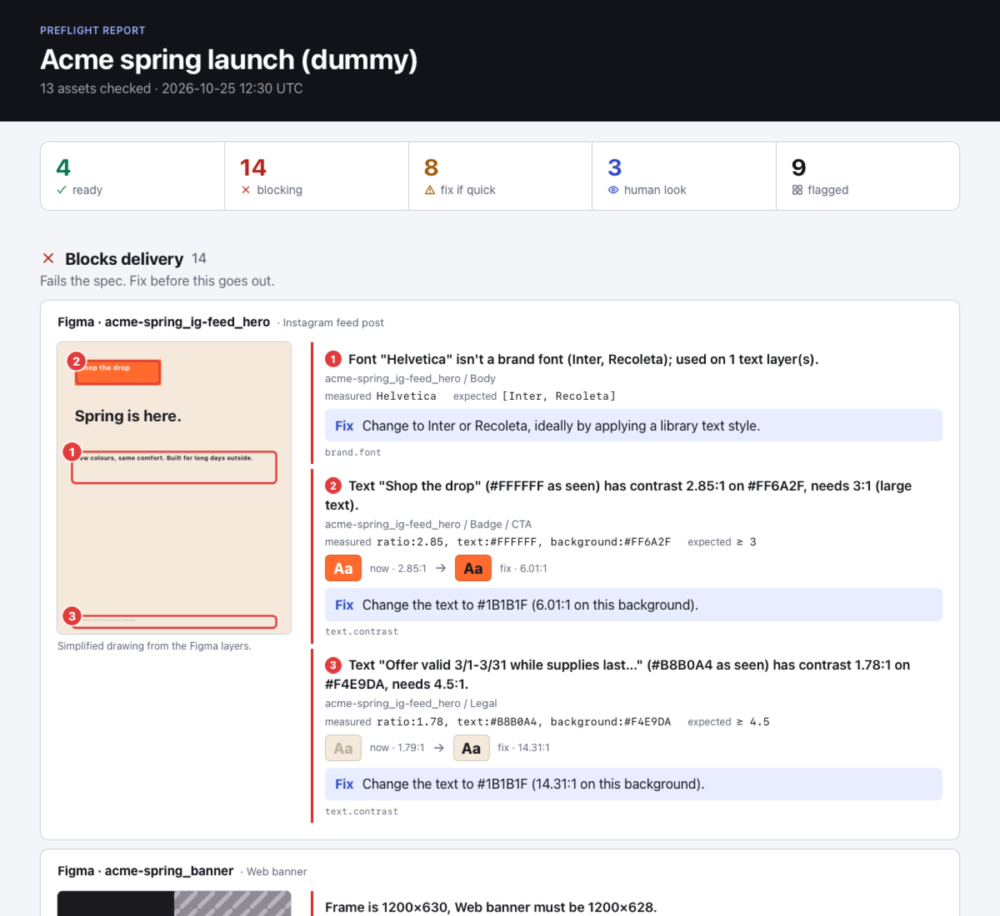
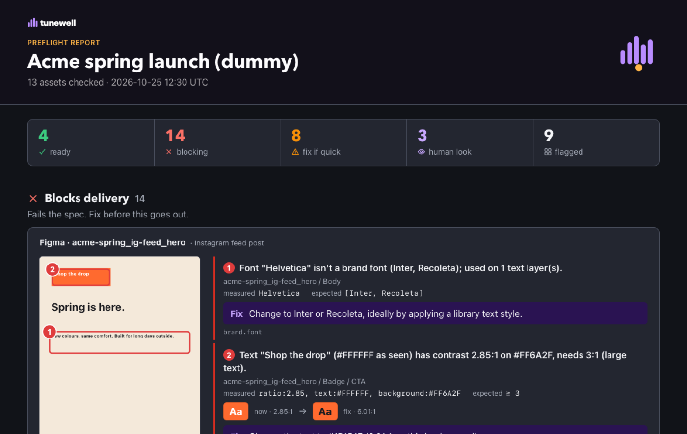
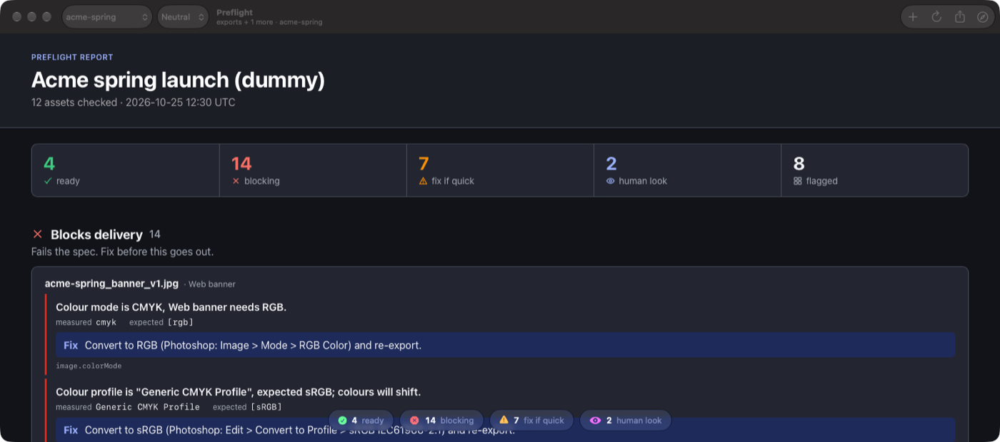

# Preflight

Checks design exports and Figma files against a project's delivery guidelines, before anyone else has to. It measures
deterministically: sizes, formats, colour profiles, frame rates, loudness, palette and font use, contrast, naming. It
then says what fails the spec, how to fix it, and what still needs a human eye.

It runs three ways, all on the same core and with the same findings:

- **In the browser** (`site/`, built with `bun tools/web/build.ts`). Drop files or a folder. Nothing is uploaded.
- **As a Mac app** (`tools/mac-app/build.sh` → `dist/Preflight.app`). Drop or open, then share the report.
- **From the command line** (`node src/cli.ts`), for scripts, CI, and AI assistants that triage the JSON report.



| The report page | With a brand profile (dark mode) | The Mac app |
|---|---|---|
|  |  |  |

| source | checks |
|---|---|
| images (PNG, JPEG, WebP, AVIF, HEIC, TIFF, PSD, GIF, BMP, SVG) | size (exact, a list of accepted sizes, bounds, aspect ratio, long/short limit; names 2× exports), format vs content, file size, damage/truncation, colour mode (CMYK), embedded colour profile, transparency, EXIF rotation |
| video (MP4, MOV, …) | the same size rules, frame rate, codec, duration, audio codec/channels/sample rate/bitrate, loudness (EBU R128), true peak, black frames at head/tail, rotation flags |
| audio (WAV, MP3, OGG, …) | codec, channels, sample rate, bitrate, duration, loudness, true peak |
| Figma frames (incl. inside sections) | frame size, safe areas, logo/badge minimum size and clear space, colours outside the palette (CIEDE2000), non-brand fonts, small text, WCAG contrast against what's underneath, text without a shared style |
| any file | naming convention |

Every finding carries the rule, severity, measured value, expected value and, where one fix is unambiguous, that fix.
Nobody re-measures, and an assistant reading the report doesn't improvise.

In the browser, video and audio give size and length only. Frame rate, codec, loudness and black frames need ffmpeg,
so the app or the CLI.

## Run it

Needs Node 23.6+ (or Bun) and, for video, `ffmpeg`/`ffprobe` on the PATH. There are no packages to install.

```sh
node src/cli.ts check -g examples/projects/acme-spring.json examples/spring-launch            # text summary
node src/cli.ts check -g examples/projects/acme-spring.json --html report.html examples/spring-launch
node src/cli.ts check -g examples/projects/acme-spring.json --compact examples/spring-launch > report.json
node src/cli.ts match -g examples/projects/acme-spring.json -g examples/projects/streaming-delivery.json examples/spring-launch
FIGMA_TOKEN=... node src/cli.ts check -g guidelines.json https://www.figma.com/design/KEY/Name
node --test test/
```

A source can be:

- a file;
- a folder, walked recursively (any `*.figma.json` inside is read as a Figma file);
- a Figma link: `?node-id=` narrows it to one frame, and branch links check the branch;
- `figma:KEY`.

The exit code is 1 when anything fails at `error` severity, so the command can gate a folder in a script. `--compact`
keeps only the findings, small enough to upload to a chat. `--json` adds every measured fact.

## Guidelines

Each project has one JSON file; `examples/projects/acme-spring.json` is a complete example. Comments (`//` and
`/* */`) and trailing commas are allowed, so each rule can say where it comes from. Every key is optional, and a
missing key means "don't check that". Mistakes are rejected, never ignored: typos, wrong types ("1080" for 1080),
unknown rule names, and naming patterns that could hang.

- `naming.pattern`: a regex every file name must match.
- `brand`:
  - `palette` (hex) and `paletteTolerance` (CIEDE2000, default 1.0)
  - `fonts`
  - `minTextSize` (px)
  - `minContrast` (WCAG ratio)
  - `logos`
- `deliverables[]`: each is matched by a glob on the file or frame name (`*_ig-feed_*`). Its keys are `width`,
  `height`, `formats`, `maxBytes`, `colorProfile`, `colorMode`, `transparency`, and `video`. The `video` keys are
  `fps`, `codec`, `min/maxDurationS`, `audio`, `loudness {targetLufs, tolerance, maxTruePeakDb}` and
  `maxBlackAtEdgesS`.
- `severity`: per-rule overrides, e.g. `{ "naming.pattern": "info" }`.

`examples/projects/streaming-delivery.json` encodes real platform specs, each with its source: Spotify Canvas and
audio ads, Apple Podcasts, YouTube thumbnails, App Store screenshots and previews, Google Play. `examples/streaming/`
generates a test set with known defects (see its EXPECTED.md).

## Brand profiles

The report page has a plain, neutral look by default. A brand profile restyles it: logo, mark, fonts and colour tokens
in a small JSONC file next to its logo files (see `examples/brands/tunewell/`). A profile can also set
`"style": "bold"` for a poster-like page: a curved hero header with a large mark, floating stat cards and pill headings. `node src/cli.ts brand pack PROFILE.jsonc
OUT.json` embeds the images, so the single file works in the browser, the app and `--brand`.

## With an AI assistant

1. Give the assistant `agent/instructions.md` as its instructions. This works in a ChatGPT or Claude Project, a Dust
   agent, or with a local model.
2. Run the CLI with `--compact` and upload `report.json`.
3. Ask it to review. The `agent/triage-*.md` files are sample outputs.

The `assist` commands go further, and their output is clearly labelled as AI-suggested:

- `assist feedback` turns past review comments into proposed guideline rules.
- `assist localize` compares the locale variants of a Figma file.
- `assist visual` asks a vision model about logo use and cropping.

Set the model with `PREFLIGHT_LLM_URL`, `PREFLIGHT_LLM_MODEL` and `PREFLIGHT_LLM_EFFORT`, or use `claude-code`.

## MCP server (experimental, localhost only)

`node src/mcp.ts` serves the same checks as MCP tools (`check_figma`, `check_urls`, `check_folder`,
`validate_guidelines`, `list_projects`) over stateless Streamable HTTP on 127.0.0.1. It is **not hardened for
exposure**: `check_urls` has no SSRF filtering, checks run synchronously, and there are no rate limits.

## Private kits

Team-specific guidelines, brand profiles and demos can live in a separate repo laid out like this one, copied over a
checkout. The app build packs every `examples/brands/*/brand.jsonc` it finds. A brand directory may include an
executable `prepare.sh` that fetches logo files the kit can't redistribute.

## Layout

- `src/`: the checker. The core has no Node imports, which is what the browser build bundles. The Node-only parts
  are `io.ts`, `run.ts`, `core.ts`, `cli.ts`, `mcp.ts`, `formats/video.ts` and `assist/`. `formats/inflate.ts`
  re-exports node:zlib, and the browser build swaps in `inflate.browser.ts`.
- `src/web/`: the browser front end.
- `tools/mac-app/`: the Mac app.
- `tools/web/`: the site build.

## What it doesn't do

- Judge taste, layout or copy. The `assist` commands can suggest, clearly labelled.
- Read After Effects or Premiere project files. Check the renders instead.
- Decode pixels beyond PNG alpha. Sizes, colour mode and profiles come from the headers, and PSD layers and text are
  not read.
